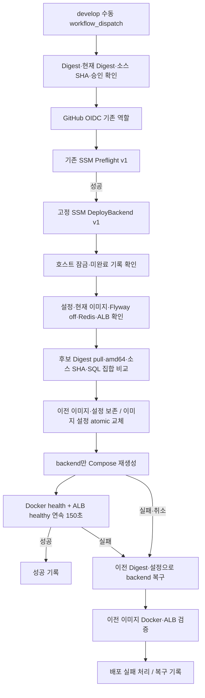

# ECR digest → EC2 수동 배포와 롤백

Issue #34. 기존 ECR Push 및 Preflight Workflow는 유지합니다. 이 문서의 AWS/호스트
설치 명령은 **검토·승인 후 사용자가 별도로 수행할 절차**입니다. 이번 구현 작업에서는
AWS 리소스 생성/변경, SSM 실행, EC2 배포, 실제 Secret 조회, 마이그레이션을 하지 않습니다.

## 아키텍처와 변경 범위



- 계정 `494915081306`, 리전 `ap-northeast-2`, 저장소 `hobbytree/backend`.
- EC2 `i-0d71fcf646b7210f2`, 대상 그룹
  `arn:aws:elasticloadbalancing:ap-northeast-2:494915081306:targetgroup/hobbytree-backend-tg/07f8122d999a820d`.
- 기존 `hobbytree-ec2-preflight.yml`, `ecr-push.yml`, Compose, systemd unit, 업무 코드,
  Flyway SQL을 변경하지 않습니다. 신규 호스트 스크립트와 검토용 SSM/IAM 파일을 추가합니다.
- GitHub는 이미지나 셸 명령을 EC2로 전송하지 않습니다. 고정 문서/버전/인스턴스에
  digest 2개, 소스 SHA, 요청 ID, 고정 승인 문구만 전달합니다.
- SSM은 설치된 root 전용 스크립트의 SHA256/소유권/모드를 확인한 뒤 실행합니다.
  `ENV_VAR`와 `allowedPattern`을 사용하며 사용자 문자열을 셸 코드에 직접 치환하지 않습니다.

## 기존 구성과의 호환성

기존 systemd unit은 `oneshot`/`RemainAfterExit=yes`입니다. 재시작 시 Secrets를 다시
준비하고 Redis 유지/기동 단계를 실행하므로 자동 이미지 배포에서는 **systemctl restart를
호출하지 않습니다**. 현재 active/exited unit을 확인하고 `.env.ec2`의 BACKEND_IMAGE만
atomic 교체하여 재부팅에도 선택한 digest를 사용하도록 합니다. 기존 Secret 파일을 검증만 하며
새로 조회/쓰기/회전하지 않습니다. 이후 backend만 다음 옵션으로 교체합니다.

```text
docker compose --project-name hobbytree --project-directory /opt/hobbytree
  --env-file /opt/hobbytree/.env.ec2 -f /opt/hobbytree/compose.ec2.yml
  up -d --no-build --pull never --no-deps --force-recreate
  --wait --wait-timeout 180 backend
```

Redis는 inspect만 합니다. 컨테이너 ID와 Mounts가 그대로인지 전후 검증합니다.
Redis의 up/restart, down, volume 삭제, prune, DB 초기화 명령은 실행하지 않습니다.
실행 중인 서비스 설정이 저장소의 검토된 Compose/validator/unit과 다르거나 파일 소유권이
root가 아니면 배포를 거절합니다. 실제 EC2 파일 원문과 현재 backend digest는 이번 작업에서
조회하지 않았으므로, 승인된 설치 전에 운영자가 차이를 검토해야 합니다. 기존 파일을 무조건
저장소 버전으로 덮어쓰면 안 됩니다.

2GiB EC2에서 기존 1GiB backend와 384MiB Redis 제한을 유지하고 이미지 빌드나 두 번째
실행 중인 backend를 추가하지 않습니다. jar 검사 파일은 RAM tmpfs가 아닌 보호된 디스크의
임시 폴더를 사용하며 Docker/감사 기록 파일시스템 각각 여유 3GiB 이상을 요구합니다.
지원 이미지 크기는 1GiB 이하입니다. ECR 로그인 파일만 root 전용 `/run` 임시 폴더를 사용하고
정상 종료 시 제거합니다. 강제 종료 뒤 남은 staging 파일은 담당자가 소유권/요청을 확인 후
정리하며, 배포 과정에서 기존 Docker 이미지/볼륨을 prune하지 않습니다.

## 이미지·스키마·데이터 승인

수동 입력은 `image_digest=sha256:<64 hex>`, `expected_current_digest=sha256:<64 hex>`,
`image_revision=<40 hex Git SHA>`입니다. 기존 ECR Push가 검증·게시한 이미지의 digest와
소스 SHA를 사용합니다. tag/latest는 허용하지 않습니다. 호스트에서 실제 현재 이미지의
RepoDigest와 입력을 대조하고, 후보의 platform/non-root/entrypoint 및 OCI revision label을
확인합니다. label은 서명된 증명서가 아니므로 ECR push 주체와 원본 CI 성공도 운영자가 확인합니다.

현재/후보 이미지는 시작하지 않은 격리 임시 컨테이너에서 jar만 복사합니다. 정렬된
`BOOT-INF/classes/db/migration/V*__*.sql` 이름/내용을 SHA256으로 비교합니다. 줄 끝만
정규화하며 SQL을 실행하지 않습니다. 추가/삭제/내용 변경이나 지원하지 않는 migration
레이아웃은 **서비스 교체 전에 차단**합니다. jar 256MiB, SQL 합계 2MiB 제한이 있습니다.

이 비교는 실제 RDS Flyway 이력 조회나 비즈니스 데이터 역호환성의 증명이 아닙니다.
수동 실행 전에 운영자가 Flyway info/validate와 Pending 여부, schema/JPA 정합성, 이전/신규
코드의 데이터 쓰기 호환성을 별도 확인해야 합니다. `SPRING_FLYWAY_ENABLED=false`,
`ddl-auto=validate`, ec2 profile 및 대체 Spring/JVM 설정 소스 금지를 전후 검사합니다.
이 자동화에는 migration 승인 bypass나 migration 계정/Secret/DDL 권한이 없습니다.

SQL 집합이 다른 신규 배포는 이 Workflow로 강행할 수 없습니다. 별도 Issue와 명시적 승인을
받아 스냅샷/이력/신구 앱 호환성/서비스 중단 순서를 검토하고 마이그레이션·기준 이미지 전환을
따로 수행해야 합니다. 승인 없이 SQL을 수정하거나 Flyway를 켜지 않습니다.

## 단일 EC2 중단과 ALB 검증

동일한 8080 포트를 쓰는 컨테이너를 교체하므로 무중단 배포가 아닙니다. 기존 앱은
graceful shutdown 30초/Compose grace 40초이며 새 기동과 ALB 상태 수렴 동안 오류가
발생할 수 있습니다. 이미지 pull·검증은 기존 앱이 실행 중인 동안 먼저 수행합니다.

2026-11-03 읽기 전용 확인: 기존 target은 instance/8080, HTTP `/actuator/health`,
traffic-port, timeout 5초, interval 30초, healthy 5회/unhealthy 2회, HTTP 200, healthy입니다.
이 계약이 달라지면 타이밍 검토 없이 배포하지 않습니다. Docker가 정확한 새 image ID로
healthy인 것을 확인한 뒤 ALB healthy를 150초 연속 관찰하여 이전 상태 하나만 보고
성공 처리하지 않습니다. 상태 회복까지 포함한 ALB 관찰 한도는 420초입니다.

모든 대상이 unhealthy면 ALB는 fail-open하여 요청을 계속 전달할 수 있습니다. 이 구현은
대상을 deregister하거나 ALB/리스너를 변경하지 않습니다. 신규 앱이 최종 검증 전에 요청을
처리할 수 있으므로 롤백은 이미지/설정만 복구하며 이미 처리한 DB/Redis 업무 쓰기는 되돌리지
않습니다. 운영자는 중단과 데이터 역호환성을 검토하고 세 승인 체크박스를 직접 확인해야 합니다.

## 동시 실행·기록·실패 처리

- GitHub concurrency `hobbytree-ec2-image-deployment`, cancel-in-progress=false.
- 호스트 `/var/lib/hobbytree/deployments/lock`의 nonblocking flock. GitHub 관찰이 취소돼도
  원격 스크립트가 계속 실행 중이면 호스트 잠금이 두 번째 배포를 막습니다.
- 요청 ID는 GitHub run ID-attempt이며, 이미 기록된 요청은 재실행하지 않습니다.
  같은 현재/후보 digest는 검증 후 no-op이며 backend를 재생성하지 않습니다.
- 각 요청 폴더에 원래 설정 `settings.before`와 요청 ID·후보/이전 이미지·소스 revision·이미지 ID·설정/SQL hash·상태를 담은
  `release.json`을 root 전용으로 보존합니다. `active.json`은 미완료/rollback-failed이면
  이후 배포를 막습니다. 오래된 파일을 자동 삭제하지 않습니다. 용량/보존은 운영자가 관리합니다.
- 검토된 Compose 원문도 `compose.approved.yml`로 보존하고 교체/롤백에 같은 사본을 사용합니다.
  원본 Compose를 다시 읽어 복구 동작이 달라지는 것을 막습니다. jar가 symlink이면 검사하지 않고 거부합니다.
- 실패/KeyboardInterrupt/SIGTERM 시 이전 digest로 설정을 복구하고 backend만 재생성한 뒤
  Docker와 ALB를 재검증합니다. 롤백이 성공해도 이번 배포 Workflow는 실패합니다.
- SSM 응답 코드 10은 이전 이미지 복구·검증 완료, 20은 복구 실패/기록 실패로 수동 대응이
  필요하다는 뜻입니다. 그 외 비정상 코드는 성공으로 처리하지 않습니다. GitHub는 원격 로그를
  읽지 않고 이 정수 코드로 결과를 구분합니다. 보호된 journal에는 위 공개 메타데이터와
  진행/실패/복구 단계, 안전한 실패 진단을 기록합니다. 진단은 코드에 고정된 `ReleaseError`
  메시지 또는 외부 예외의 클래스 이름뿐이며, 원격 출력이나 외부 예외 메시지는 기록하지 않습니다.
- 설정이 외부에서 수정되었으면 무조건 덮어쓰지 않고 manual recovery로 전환합니다.
  배포 중 수동 Compose/systemctl/Secret 회전은 금지합니다. 협조하지 않는 root 관리자의
  명령까지 flock으로 통제하는 것은 아닙니다.
- 강제 종료/SIGKILL/호스트 장애/디스크 장애는 자동 복구 완료를 보장하지 않습니다.
  미완료 journal을 유지해 새 자동 배포를 막고 담당자가 복구해야 합니다.
- 전진 단계 1200초, 복구 단계 최대 720초. SSM plugin 2100초, SendCommand TimeoutSeconds 120초,
  GitHub 결과 관찰 2400초, deploy job 55분, guard job 3분입니다. 큐 대기는 별도이며
  job 취소가 원격 SSM 취소를 의미하지 않습니다. 명령 ID는 즉시 flush합니다.
- SSM의 TimedOut/Cancelled도 이전 이미지 복구 완료를 뜻하지 않습니다. Agent의 실행 제한이나
  강제 종료로 복구 코드가 끝까지 실행되지 않을 수 있으므로 SSM 상태와 journal·실제 서비스를
  함께 확인해야 합니다. GitHub 관찰 실패만 보고 다시 실행하거나 journal을 지우지 않습니다.

## AWS 콘솔 변경 전 보안 검토와 승인

다음은 **구현 완료와 별개의 운영 승인 항목**입니다. 이번 PR은 설치·권한 부여를 실행하지 않습니다.

1. PR/CodeRabbit/CI 검증 후 사용자가 Merge Commit으로 병합합니다. 팀원 승인은 필수가 아닙니다.
2. SSM 문서와 host script 전체를 검토합니다. root 코드 실행 권한이므로 입력 제약, script hash,
   root 소유권, 고정 경로, backend 전용 변경, SQL 비교, 롤백/미완료 차단을 확인합니다.
3. EC2 현재 파일을 출력 없이 검토하고 검토된 source LF bytes와 맞는지 확인합니다.
   Compose/unit/validator 차이는 원인을 검토하여 별도 승인해야 하며 자동 덮어쓰지 않습니다.
4. 승인된 script를 `/opt/hobbytree/scripts/deploy/ec2-release.py`에 root:root 0500으로,
   `deploy/ec2-deployment-contract.json`을 `/etc/hobbytree/deployment-contract.json`에 root:root
   0600으로 설치합니다. 디렉터리와 조상은 root 소유, symlink/그룹·타인 쓰기 금지입니다.
   `.env.ec2`도 root:root 0600이고 템플릿의 비밀 없는 식별자만 포함해야 합니다.
   소스 전체가 있는 검토된 checkout에서 다음 파일 생성/검사를 할 수 있습니다.

   ```bash
   python3 scripts/deploy/render-artifacts.py --check
   # 파일/권한 설치는 실제 EC2 변경이므로 별도 승인 후 수행
   sudo install -d -m 0755 /opt/hobbytree/scripts/deploy
   sudo install -m 0500 scripts/deploy/ec2-release.py /opt/hobbytree/scripts/deploy/ec2-release.py
   sudo install -d -m 0700 /etc/hobbytree
   sudo install -m 0600 deploy/ec2-deployment-contract.json /etc/hobbytree/deployment-contract.json
   ```

5. SSM 콘솔 서울 리전에서 **Command / JSON** 문서 `HobbyTree-Dev-DeployBackend`를
   `deploy/ssm/HobbyTree-Dev-DeployBackend.json`으로 생성합니다. 첫 버전은 1이어야 합니다.
   최신 ENV_VAR 지원 Agent를 확인합니다. 기존 확인 버전은 3.3.5390.0입니다.
   문서가 이미 있으면 임의로 덮어쓰거나 새 default로 바꾸지 말고 버전·hash를 검토합니다.
6. IAM 검토 후에만 GitHub 역할 `hobbytree-github-ec2-deploy-role`에
   `deploy/iam/github-ec2-deployment-policy.json`을 적용합니다. 기존 Preflight와 새 Deploy 문서,
   고정 인스턴스의 SendCommand + GetCommandInvocation만 포함하며 Secret/ECR push/RDS/
   문서 생성·수정/임의 셸 명령 권한은 없습니다. GetCommandInvocation은 Resource `*`가
   필요하고 리전 조건을 둡니다. 기존 관련 인라인 정책을 대체하지 않고 새 Allow만 추가하면
   이전 Allow는 계속 유효하므로 조건이 실제로 좁혀졌다고 가정하지 않습니다.
   `--query`는 클라이언트 출력 제한이며 IAM 권한 제한이 아닙니다. 이 역할은 명령 ID를 아는
   같은 계정·리전의 다른 invocation 출력도 조회할 수 있으므로, 다른 SSM 작업도 Secret을
   출력하지 않아야 합니다. 고정 인스턴스의 결과만 읽는다고 가정하면 안 됩니다.
7. EC2 역할에는 `deploy/iam/ec2-release-read-policy.json`에 필요한 읽기 작업만 허용합니다.
   기존 `AmazonEC2ContainerRegistryPullOnly`로 ECR pull이 이미 가능하므로 중복 추가할 필요는
   없습니다. 파일의 ECR 부분은 repository 한정 대체 정책 검토용이며, 기존 광역 관리형 정책을
   그대로 두면 대체 정책을 추가해도 전체 권한이 좁아지지 않습니다. 새로 필요한 ALB
   DescribeTargetGroups/DescribeTargetHealth는 resource-level 권한을 지원하지 않아 `*`와 리전
   조건을 사용합니다. 기존 SSM/S3/DB·auth Secret 권한은 변경하지 않습니다.
8. 기존 OIDC trust의 audience/develop immutable subject는 유지합니다. 새 AWS Access Key나
   GitHub DB Secret은 등록하지 않습니다. GitHub 역할은 SSM 문서를 생성/변경할 수 없어야 합니다.
   SendCommand 권한은 문서 ARN에 적용되므로 다른 문서 버전을 만들 권한은 별도 관리자만 관리합니다.

호스트 스크립트가 바뀌면 renderer를 다시 실행해 hash를 갱신하고 함께 리뷰해야 합니다.
이미 생성한 SSM 버전 1을 수정할 수 있다고 가정하지 않습니다. 후속 변경은 새 SSM 문서
버전과 클라이언트의 고정 document-version 변경, 호스트 설치 순서를 별도 검토·승인해야 합니다.

## 실제 배포 승인과 실행

운영 담당자는 (a) 검증된 ECR Push run/소스 SHA/digest, (b) 현재 실행 RepoDigest와 기존 설정,
(c) app 계정·TLS·RDS Flyway 이력/Pending 없음, (d) SQL 집합과 업무 데이터 롤백 호환성,
(e) DB 백업 및 이전 이미지 캐시/디스크 여유, (f) 중단 일정/ALB fail-open/복구 담당자를 확인합니다.
초기에는 별도 마이그레이션이 필요한 배포를 이 Workflow로 승인할 수 없습니다.

첫 배포 전에 다음을 별도로 확인하고 실행 기록에 남깁니다. 아래 AWS/백업 작업은 이 PR이
수행하는 작업이 아니며, 실제 생성·복구·접속에는 운영자의 별도 승인이 필요합니다.

- RDS의 최근 복구 지점/수동 스냅샷이 Available인지, 생성 시각·보존 기간·복구 권한을 확인합니다.
  이전에 만든 스냅샷이 현재도 존재하거나 최근 쓰기를 포함한다고 가정하지 않습니다.
- Redis AOF 유지가 백업을 대신하지는 않습니다. 실제 `hobbytree` 프로젝트의 `/data` named
  volume 위치와 암호화된 복구 가능한 백업을 확인합니다. 백업은 Redis 일관성을 보장하는
  별도 승인 절차로 확보하며, 실행 중인 AOF 파일을 단순 복사해 유효한 백업으로 간주하지 않습니다.
- EC2 장애에도 복구할 수 있도록 검토된 Compose/unit/script/계약·비밀 없는 환경 설정·journal의
  보호된 호스트 외부 사본과 이전 이미지의 ECR 보존을 확인합니다. 로컬 Docker 캐시만 믿지 않습니다.
  Secret 평문을 백업·로그로 내보내지 않고 Secrets Manager의 식별자/필요 버전과 복구 권한을 관리합니다.
- GitHub 배포 역할과 별개인 운영자 복구 경로(승인된 Session Manager 또는 EC2 복구 경로),
  담당자·연락 수단·예상 복구 시간과 기존 앱/ALB 상태 확인 방법을 준비합니다. 배포 역할에
  임의 셸·SSM 문서 수정·DB 복구 권한을 추가해 해결하지 않습니다.
- 신구 앱의 SQL 집합뿐 아니라 실제 Flyway Pending 없음, app 계정/TLS, 데이터 쓰기·세션
  형식의 롤백 호환성을 확인합니다. 이미지/소스 SHA/성공한 원본 CI를 대조하고 후보·이전 digest를 기록합니다.
- 현재 backend/Redis ID·mounts·Docker health·ALB health, 호스트 파일 hash/권한, 디스크 여유,
  미완료 journal 없음, 중단 일정/ALB fail-open 허용을 확인합니다. 백업 복구 가능성이나
  호스트 호환성이 미확인이면 첫 배포를 승인하지 않습니다.

기본 브랜치 develop에 병합된 뒤 Actions → **HobbyTree EC2 Image Deployment** → Run workflow,
branch develop을 선택합니다. 위 digest/SHA와 세 확인 항목을 입력합니다. ECR tag를 바꿔도
선택한 digest는 바뀌지 않습니다. Preflight 실패, CAS 불일치, SQL 차이, 파일/ALB drift는
배포를 중단합니다. 신규 이미지 빌드/ECR push는 이 Workflow에서 하지 않습니다.

## 롤백과 수동 복구

정상 실패 시 자동 롤백 로그/SSM 종료 코드를 확인하고, 보호된 journal의 status와 현재
backend digest/Docker healthy/ALB healthy를 확인합니다. `rolled-back`은 성공한 배포가 아니므로
원인을 수정하고 현재 상태를 다시 읽은 후 새 실행을 승인합니다.

`prepared`, `changing`, `rolling-back`, `rollback-failed`가 남거나 SSM/Workflow가 강제 종료됐으면:

1. 새 배포를 시작하지 말고 해당 SSM command가 아직 실행 중인지 확인합니다. 원격 실행이
   끝나지 않았으면 같은 호스트에서 수동 복구와 경쟁시키지 않습니다. 종료 확인 후에도 동일한
   `/var/lib/hobbytree/deployments/lock`의 nonblocking 독점 flock을 획득한 root 복구 세션 안에서
   아래 절차를 수행합니다. 잠금 실패 시 중단하고 lock 파일을 삭제·교체하지 않습니다.
2. root로 `release.json`의 이전 digest/image ID와 `settings.before`를 검토하되 설정 내용이나
   Secret을 로그에 출력하지 않습니다. 데이터 쓰기/스키마 변경이 있었다면 먼저 별도 DB 대응을 승인합니다.
   `prepared`도 비터미널 상태여서 다음 배포를 차단합니다. 잠금을 유지한 채 실제 환경 설정이
   `settings.before`와 같고 이전 digest/image ID가 실행 중이며 Redis ID·mounts와 Docker/ALB
   상태가 정상인지 확인합니다. 실제 서비스 변경이 없었다고 확인된 경우에만 3~4의 재생성을
   생략하고 5의 복구 종료 기록을 수행합니다. 상태 문자열만 보고 변경 전이라고 추정하지 않습니다.
3. 현재 설정의 외부 변경 유무를 확인한 뒤 원본 설정의 BACKEND_IMAGE만 이전 **digest**로
   atomic 복구합니다. 이전 이미지는 prune하지 않았으므로 캐시가 있어야 합니다.
4. 해당 요청의 `compose.approved.yml`을 검토된 동일 버전 계약의 Compose hash와 대조합니다.
   현재 `/opt/hobbytree/compose.ec2.yml`로 대체하지 않습니다. 사본이 없거나 hash가 다르면
   중단하고 검토된 버전을 복원하는 별도 복구 판단을 받습니다. 이전 digest가 로컬에 없으면
   승인된 운영자 경로로 ECR에서 동일 digest를 확보하고 image ID를 확인한 뒤 진행합니다.
   다음 명령은 **원래 설정의 BACKEND_IMAGE를 이전 digest로 복구한 후, 잠금을 가진 세션**에서만
   실행합니다. 요청 ID는 예시이며 실제 사고 요청으로 교체해야 합니다.

   ```bash
   release_dir=/var/lib/hobbytree/deployments/123456789-1
   docker compose --project-name hobbytree --project-directory /opt/hobbytree \
     --env-file /opt/hobbytree/.env.ec2 -f "$release_dir/compose.approved.yml" \
     up -d --no-build --pull never --no-deps --force-recreate \
     --wait --wait-timeout 180 backend
   ```

   Docker image ID/healthy, Redis ID·mounts 유지, ALB healthy 150초 연속과 주요 인증 요청을
   확인합니다. systemd restart/down/volume 삭제 금지.
5. 이전 이미지/설정과 Docker·ALB 복구 검증 후에만 `active.json.status`를 반드시 `rolled-back`으로
   atomic 기록하도록 승인합니다. 기존 실패 당시 journal·metadata를 보존하고 복구 시각·담당자·검증
   근거를 감사 기록에 남깁니다. 실패한 배포를 `succeeded`나 `no-op`로 기록하거나 journal을 먼저
   지워서 차단만 우회하지 않습니다. 이 관리 작업은 SSM 배포 문서 입력으로 노출하지 않으며
   root 운영자만 수행합니다.

이미지 복구로 해결되지 않는 데이터 장애는 RDS/Redis를 즉시 덮어써서 해결하지 않습니다.
RDS 스냅샷 복원은 새 인스턴스/엔드포인트와 손실 가능한 쓰기 시점까지 검토하는 별도 복구이며,
Redis 과거 백업은 폐기된 세션을 되살릴 수 있으므로 세션 무효화 필요성도 별도로 판단합니다.
DB/Redis 복구는 승인·일관성/데이터 손실 검토 후 별도 실행하고 이 배포 문서로 수행하지 않습니다.

## 검증 범위

AWS/Docker subprocess 모의 테스트로 성공, 시작/health/ALB 실패, 취소, 롤백 실패, 설정 drift,
SQL 변경, 중복 요청, 관찰 시간/timeout, 입력 주입, 로그 비노출을 검증합니다. 실제 flock과
root 권한/심볼릭 링크 검사는 Linux CI에서 실행합니다. 기존 CI의 Java/Spotless/Docker/
PostgreSQL/Redis 검증을 유지합니다. SSM 문서의 AWS 서버 수락과 실제 ECR→EC2→ALB 및
강제 종료 복구는 이번 작업에서 실행하지 않았으며 운영 권한을 주기 전 검토와 최초 실행 승인이 필요합니다.

## 공식 근거

- [SSM schema 2.2와 ENV_VAR](https://docs.aws.amazon.com/systems-manager/latest/userguide/documents-schemas-features.html)
- [Compose backend 전용 up 옵션](https://docs.docker.com/reference/cli/docker/compose/up/)
- [ALB health 및 fail-open](https://docs.aws.amazon.com/elasticloadbalancing/latest/application/target-group-health-checks.html)
- [SSM IAM 작업/리소스](https://docs.aws.amazon.com/service-authorization/latest/reference/list_awssystemsmanager.html)
- [ECR IAM](https://docs.aws.amazon.com/service-authorization/latest/reference/list_amazonelasticcontainerregistry.html)
